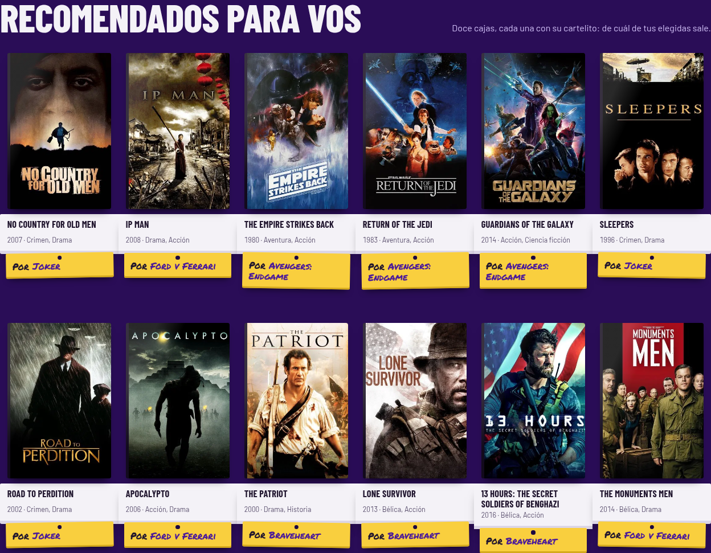
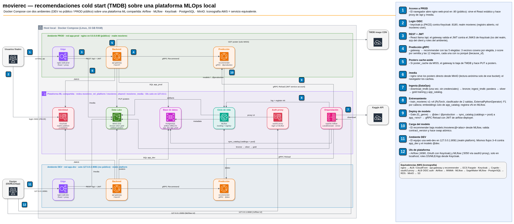
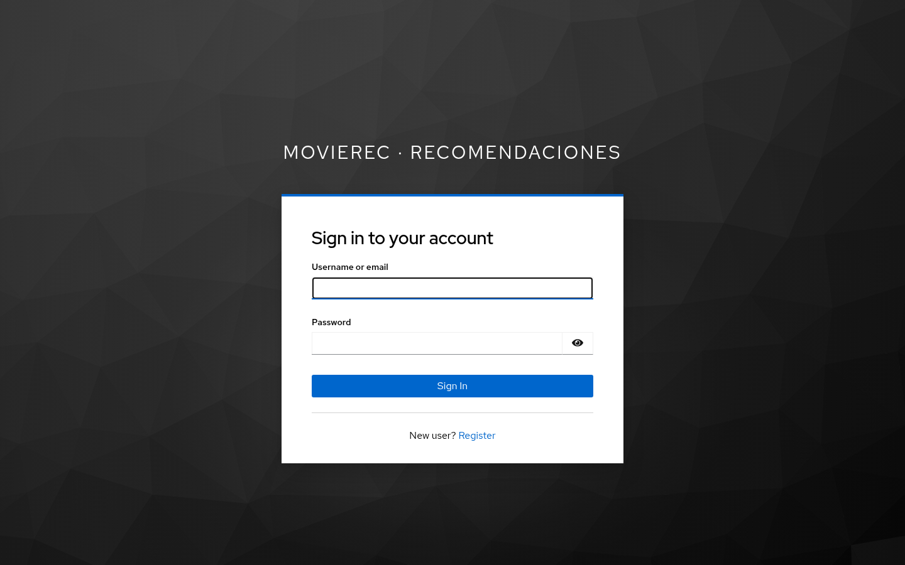
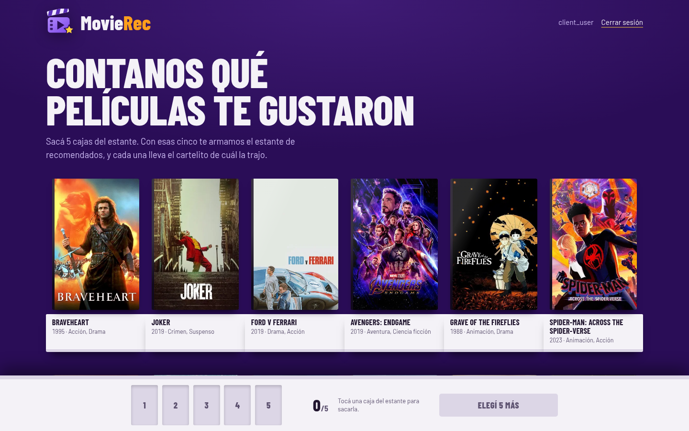
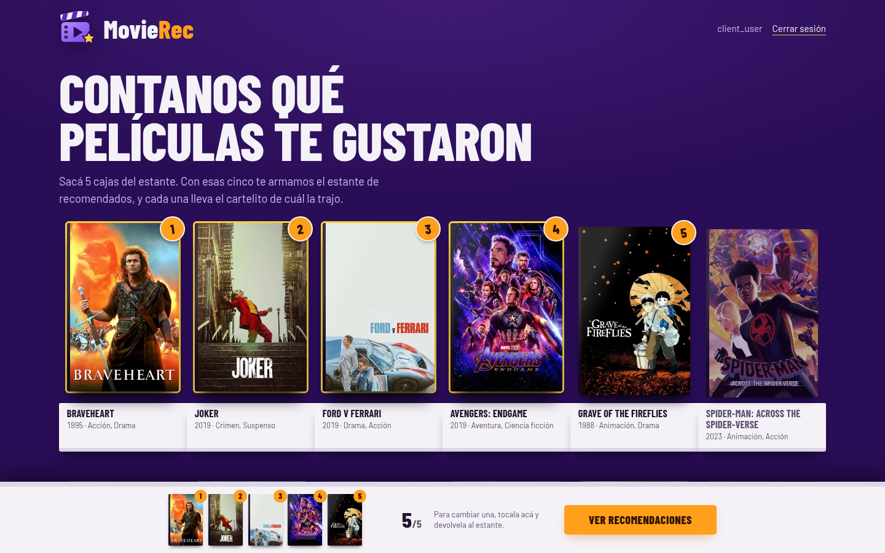
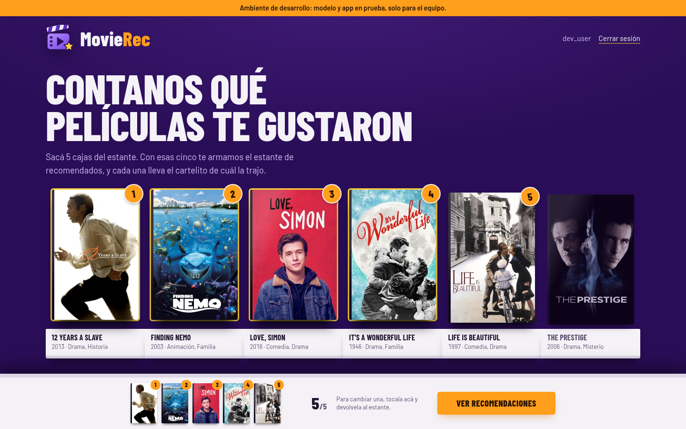
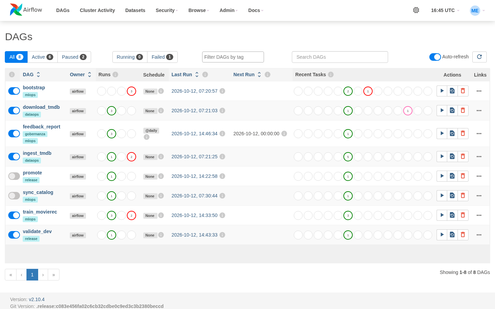
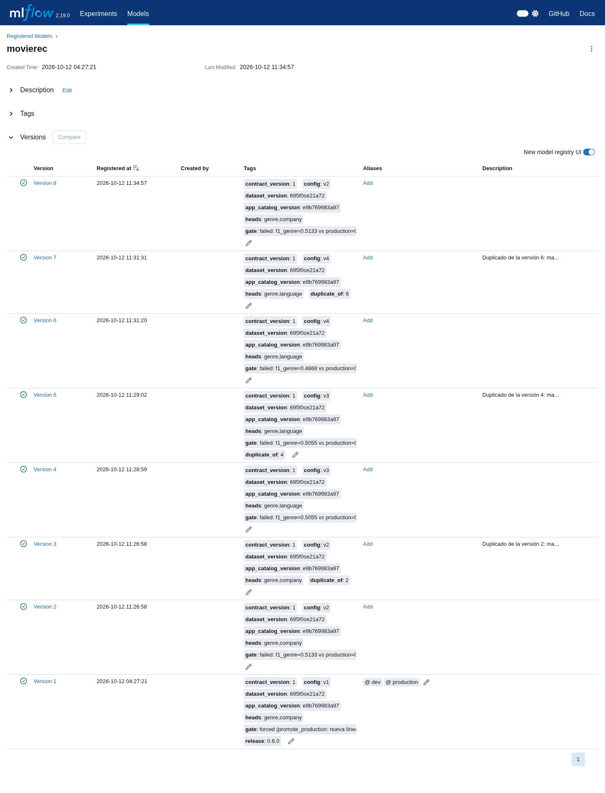
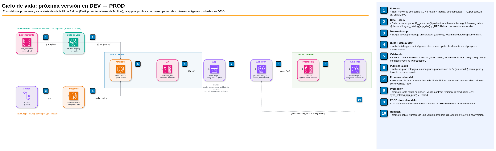

# movierec — recomendaciones de día 0 con una plataforma MLOps

Trabajo final de **MLOps II** (CEIA, FIUBA). Trabajo individual. Nivel: **contenedores**.

Un usuario nuevo de una plataforma de streaming no tiene historial: es el problema de *cold start*. movierec le muestra 24 películas populares, le pide que elija **5 que le gustaron** y le devuelve **12 recomendaciones**, cada una con el porqué ("Por Toy Story").

Detrás hay una plataforma MLOps completa, todo en Docker Compose:
- Airflow orquesta la descarga, la ingesta, el entrenamiento y la promoción de modelos.
- MLflow versiona los modelos.
- MinIO es el data lake (bronze → silver → un dataset gold por uso).
- Keycloak maneja la identidad.
- Hay dos ambientes, **DEV** (privado) y **PROD** (público).



## Qué temas de la materia muestra

| Tema | Cómo se implementa | Dónde |
|---|---|---|
| **API REST** | api-gateway en FastAPI: el único punto de entrada del frontend, con OpenAPI en `/api/docs` | `services/gateway` |
| **gRPC** | Contrato `recommender.proto` entre el gateway, Airflow y el recommender-svc. `Reload` en caliente, health y reflexión | `services/proto`, `services/recommender` |
| **Seguridad** | OIDC con Keycloak (PKCE + client credentials), JWT validados, redes segmentadas, contenedores sin root y de solo lectura, CSP, escaneo con trivy, secretos fuera del repo | [`docs/security.md`](docs/security.md) |
| **Data lake** | bronze (crudo e inmutable) → silver (limpio) → gold `training` y gold `app_catalog` (un dataset por consumidor), con contratos pandera en cada capa | [`docs/data-catalog.md`](docs/data-catalog.md) |
| **Gobernanza** | Catálogo de datos con responsables, contratos y retención; model cards; minimización de datos (la app no guarda nada de los usuarios) | [`docs/data-catalog.md`](docs/data-catalog.md) |
| **Separación de roles** | Tres roles de equipo en Keycloak (ML engineer, Data scientist, App developer) mapeados a Airflow, MLflow, MinIO y Postgres. Cada rol dispara solo sus DAGs | [`docs/roles.md`](docs/roles.md) |
| **Orquestación y ciclo de vida** | Airflow: descarga, ingesta, entrenamiento, validación, promoción y rollback, desde la UI. MLflow: tracking, registry, aliases `@dev` / `@production` y gate de métricas | `ml/dags`, `ml/src/movierec_ml` |

## Arquitectura



La plataforma compartida (`compose.platform.yml`) da servicio a dos ambientes, que salen de **la misma definición** (`compose.app.yml`):
- **PROD** es público, en `:80`, con el realm `movierec` de usuarios finales.
- **DEV** escucha solo en `127.0.0.1:8081`, con el realm `platform` del equipo.

Cada ambiente tiene su nginx, su api-gateway y su recommender-svc, sirve su propio alias de modelo y tiene su base. El diagrama editable (draw.io, 3 páginas: arquitectura local, ciclo de vida del modelo y despliegue AWS opcional) está en [`docs/architecture/movierec-architecture.drawio`](docs/architecture/movierec-architecture.drawio).

| Componente | Tecnología | Rol |
|---|---|---|
| Orquestación | Apache Airflow 2.10 (LocalExecutor) | DAGs de DataOps y MLOps. El entrenamiento corre en un venv con torch CPU (`ExternalPythonOperator`) |
| Ciclo de vida | MLflow 2.19 + PostgreSQL | tracking, registry y aliases. Proxy de artefactos: los clientes nunca reciben credenciales del bucket |
| Data lake | MinIO (fork `pgsty`, API S3) | bronze / silver / gold, artefactos de MLflow y cache de posters |
| Identidad | Keycloak 26.5 + oauth2-proxy | realms `platform` y `movierec`, login de Airflow, MLflow y frontend, service accounts |
| Serving | recommender-svc (gRPC, numpy) | carga `models:/movierec@<alias>`, valida el contrato y recomienda por semilla |
| API | api-gateway (FastAPI) | JWT por ambiente, catálogo y cache-aside de posters |
| Frontend | React 19 + Vite + nginx | onboarding de 5 películas y recomendaciones con su porqué; misma imagen para DEV y PROD (`/config.json` en runtime) |

## Requisitos

- **Docker Engine con Compose v2.** Si tu usuario no está en el grupo `docker`, usá `make <target> DOCKER="sudo docker"`.
- **En el host:** `make` y `python3`.
- **Disco:** unos **12 GB** libres para las imágenes (sobre todo Airflow con torch) y el dataset.
- **Memoria:** unos **8 GB de RAM** con todo levantado.
- **Puertos libres:**
  - en `0.0.0.0`: `80` (PROD) y `8180` (Keycloak);
  - en `127.0.0.1`: `8081` (DEV), `8080` (Airflow), `5050` (MLflow) y `9001` (MinIO).
- **Dataset:** el [Full TMDB Movies Dataset 2024](https://www.kaggle.com/datasets/asaniczka/tmdb-movies-dataset-2023-930k-movies) (unos 670 MB, licencia ODC-By). La plataforma lo baja **una sola vez y sin credenciales** desde la API pública de Kaggle. Sin internet, en `platform.env`: `MOVIEREC_BOOTSTRAP_SOURCE=local` (el CSV copiado en `data/raw/TMDB_movie_dataset_v11.csv`) o `sample` (sample versionado de 5.000 películas).

## Instalación

```bash
cd mlops2/tp-final
make secrets             # genera platform.env, dev.env y prod.env con secretos aleatorios (no se versionan)
make up-platform         # Postgres, MinIO, Keycloak, MLflow (+ oauth2-proxy) y Airflow; espera a que estén healthy
# Al arrancar, Airflow corre solo el DAG bootstrap (una única vez): descarga -> ingesta -> entrenamiento v1
# -> @dev y @production. Tarda unos minutos; se sigue en la UI (http://localhost:8080, mle_user).
make up-dev              # DEV: construye las imágenes :dev (los tests de cada servicio corren en el build)
make up-prod             # PROD con las mismas imágenes, etiquetadas :prod
```

- **Esperá a que `bootstrap` termine en verde antes de `make up-dev`:** el recommender queda *healthy* recién cuando hay un modelo para servir.
- Si `make up-platform` corta porque un servicio tardó en quedar *healthy*, volvé a correrlo: retoma desde donde quedó.

| UI | URL | Usuario / contraseña |
|---|---|---|
| App PROD | http://localhost | `client_user` / `client_user` (realm `movierec`; también se puede registrar un usuario nuevo) |
| App DEV | http://localhost:8081 | `dev_user`, `ds_user` o `mle_user` (realm `platform`) |
| Airflow | http://localhost:8080 | "Sign in with keycloak": `mle_user`, `ds_user` o `dev_user` |
| MLflow | http://localhost:5050 | `mle_user` o `ds_user` (`dev_user` recibe 403) |
| MinIO | http://localhost:9001 | `minio-admin` / `minio-admin` |
| Keycloak (admin) | http://localhost:8180/admin | `kc-admin` / `kc-admin` |

Es una plataforma de demo para uso local: **la contraseña de cada usuario es su nombre de usuario** (`mle_user` / `mle_user`, etc.). Los secretos entre servicios (bases, clients de Keycloak, usuarios de MinIO de cada servicio) los genera `make secrets` al azar. **Usá `localhost`, no `127.0.0.1`:** los redirects de Keycloak están registrados con `localhost`.

## Recorrido de la demo

**1. Login en PROD.** http://localhost redirige a Keycloak (realm `movierec`, authorization code + PKCE).



**2. Onboarding.** Aparecen 24 películas al azar de las **200 más populares de todos los tiempos**, y cambian en cada recarga.
- "Popular" se calcula con el rating ponderado bayesiano del Top 250 de IMDb, con un mínimo de 1.000 votos.
- Airflow calcula ese pool en cada sincronización del catálogo y precarga sus posters en MinIO.



**3. Elegir exactamente 5.** Las elegidas llenan la tira de abajo. El botón se habilita recién con 5, y el gateway rechaza cualquier otra cantidad.



**4. Recomendaciones con su porqué.**
1. El recommender toma los **3 vecinos más cercanos de cada película elegida**.
2. Normaliza cada similitud con un z-score por semilla.
3. Devuelve las **12 mejores**. Con 15 candidatos para 12 lugares, una semilla puede no aportar ninguna.

Cada recomendación dice de qué elegida salió. Pedir recomendaciones no guarda nada del usuario.


**5. DEV**, solo para el equipo: http://localhost:8081 con un usuario del realm `platform`. Un usuario final recibe "usuario o contraseña inválidos" y un token de PROD recibe 401. DEV sirve el modelo `@dev`.



**6. Airflow.** Muestra los DAGs y la separación de roles: `ds_user` dispara la descarga, la ingesta y el entrenamiento, pero no `promote` ni `validate_dev`.



**7. MLflow.** El registry muestra las versiones del modelo `movierec` con sus aliases `@dev` y `@production`, las métricas F1 por cabeza, los tags (`config`, `heads`, `gate`) y el model card.



**8. Nuevo modelo, de DEV a PROD, desde la UI de Airflow.**
1. `ds_user` dispara `train_movierec` con `config=v3`. Si pasa el gate, queda en `@dev` y el recommender de DEV lo recarga en caliente.
2. El equipo lo prueba en DEV.
3. `mle_user` dispara `promote` con `model_version=dev`: corre los smoke tests de DEV (`validate_dev`), asigna `@production`, sincroniza el catálogo de PROD y recarga el recommender sin reiniciarlo.
4. **Rollback:** `promote` con el número de una versión anterior (por ejemplo `model_version=1`).



## Cómo funciona

### Datos (DAGs `download_tmdb` e `ingest_tmdb`)

```
Kaggle (API pública, sin credenciales) / data/raw / sample
  -> bronze/tmdb/TMDB_movie_dataset_v11.csv   (dataset crudo, una sola vez; nunca se sobrescribe)
  -> contrato tmdb_bronze (pandera)           (si falla, se corta y el detalle queda en el log de la tarea)
  -> silver/tmdb/movies.parquet               (dataset limpio: Released, no adultas, con título y overview, dedupe)
  -> gold/training/movies.parquet             (dataset de entrenamiento: géneros, overview y keywords, vote_count > 10)
  -> gold/app_catalog/movies.parquet          (catálogo recomendable: ⊂ training, vote_count >= 200)
```

`download_tmdb` termina en *skipped* si bronze ya tiene datos. Los umbrales son fijos: más de 10 votos para entrenar y al menos 200 para recomendar, así el catálogo es siempre un subconjunto del dataset de entrenamiento. `ingest_tmdb` se puede re-ejecutar sin volver a bajar nada: silver y gold se sobrescriben. En S3 solo viven esos cuatro datasets, los artefactos de MLflow y los posters.

### Modelo (DAG `train_movierec`)

- **Clasificador de dos salidas en PyTorch:** `nn.EmbeddingBag` sobre el texto, más budget, año y categóricas (one-hot o multi-hot) → tronco compartido → dos cabezas. El **embedding de película es la salida del tronco**; las cabezas solo sirven para entrenar.
- **Cuatro configs** en `ml/configs/`:

  | Config | Texto | Tabular de entrada | Cabeza 2 |
  |---|---|---|---|
  | v1 | title, overview, tagline, keywords | budget, year, idioma | productora (top 100) |
  | v2 | title, overview, tagline | budget, year, idioma, top 30 keywords | productora (top 100) |
  | v3 | title, overview, tagline, keywords | budget, year, productora | idioma (top 15 + other) |
  | v4 | title, overview, tagline | budget, year, top 30 keywords, productora | idioma (top 15 + other) |

  La cabeza 1 siempre es géneros (multi-label).
- **Embeddings:** se entrena con gold/training. Después hay una pasada hacia adelante con los pesos finales **solo por las películas de gold/app_catalog**: es la inferencia batch del catálogo, y su resultado (un vector por película) es lo que va al bundle.
- **Métricas offline (MLflow):** `f1_genre`, `f1_company`, `f1_language` (F1 micro sobre el split test) y `f1_mean`. La cabeza que no existe en una config queda `null` en `evaluation/metrics.json`. Early stopping por `val_loss`.
- **Gate:** la versión nueva pasa a `@dev` si no empeora el `f1_genre` de `@production`.

### Modelo y resultados

Con la versión 1087 del dataset quedan 1,51 M filas crudas → 998.831 en silver → 52.960 en gold/training → 11.093 en gold/app_catalog. En training, el inglés es el 64 % de las películas y el 76 % no tiene `budget`.

| Config | Época | f1_genre | f1_company | f1_language | f1_mean |
|---|---|---|---|---|---|
| **v1** (línea de base en `@production`) | 6 | **0,533** | 0,148 | — | 0,340 |
| v2 | 6 | 0,513 | 0,149 | — | 0,331 |
| v3 | 7 | 0,506 | — | **0,752** | **0,629** |
| v4 | 8 | 0,487 | — | 0,742 | 0,614 |

- Las keywords rinden más como texto que como multi-hot: v1 > v2 y v3 > v4. El top 30 deja afuera casi todo el vocabulario de keywords.
- `f1_mean` no compara configs con cabezas distintas: el idioma, dominado por el inglés, es mucho más fácil que la productora. Por eso el gate usa `f1_genre`, la única cabeza común.
- Las F1 miden lo que se entrena (las cabezas), no la recomendación: por eso cada versión se prueba en DEV antes de promoverla.

### Serving y API

- **recommender-svc (gRPC):**
  - **Bundle de serving (contrato v2):** solo embeddings, ids (para traducir entre fila de la matriz e id de película) y manifest. Los títulos, géneros y posters no viajan en el modelo: el gateway los lee de la base del ambiente. Si el `contract_version` no es compatible, rechaza el reload y sigue con el modelo actual.
  - **Recarga:** `Reload` exige un JWT con rol `model-deployer` (la service account de Airflow) y es atómica: si falla, el servicio sigue sirviendo.
- **api-gateway (REST):**

  | Endpoint | Qué hace |
  |---|---|
  | `GET /api/health` | estado de la base, el catálogo y el modelo |
  | `GET /api/me` | usuario autenticado |
  | `GET /api/model` | modelo servido por el ambiente |
  | `GET /api/movies/onboarding` | las 24 películas del onboarding |
  | `POST /api/recommendations` | recomendaciones para 5 elegidas, con rate limit |

  - **Posters (cache-aside):** primero se bajan de TMDB, se guardan en MinIO y después se sirven desde ahí. También guarda cache negativo y usa un advisory lock por película.
  - **Sin datos de usuarios:** no se guarda qué pidió cada usuario. Los usuarios finales existen solo en Keycloak.
- **web (nginx):** sirve la SPA y es el único punto de entrada HTTP. `/api` va al gateway y `/media/posters` a MinIO (solo GET). Agrega cabeceras de seguridad.

### Promoción y rollback (DAGs `validate_dev` y `promote`)

- **`validate_dev`:** smoke tests contra DEV (health, onboarding, recomendaciones y latencia p95), y comparación de F1 entre `@dev` y `@production`. El resultado queda en el log de la tarea.
- **`promote`:** con `model_version=dev`, corre `validate_dev` y promueve la versión `@dev`. Con un número, promueve esa versión sin validar en DEV: es el rollback. En los dos casos valida el contrato, asigna `@production`, sincroniza el catálogo de PROD y recarga el recommender sin reiniciarlo. Lo dispara solo `ml-engineer`.
- **App:** `make up-dev` construye las imágenes `:dev` y `make up-prod` pasa esas mismas imágenes a PROD como `:prod`, sin reconstruir. La plataforma no se versiona: lo que tiene versión es el modelo, en el registry de MLflow. Airflow no toca contenedores: no tiene acceso al socket de Docker.

## Comandos

`make help` lista todos. El ciclo de vida del modelo se opera desde la UI de Airflow.

| Grupo | Comandos |
|---|---|
| Plataforma | `secrets`, `up-platform`, `down-platform`, `ps-platform`, `logs-platform SERVICE=x`, `clean-platform` |
| App | `build-app`, `up-dev`, `up-prod`, `down-dev`, `down-prod` |
| Calidad y seguridad | `test-ml` (los tests de recommender, gateway y web corren en el build de sus imágenes), `scan` |

## Estructura

```
tp-final/
├── compose.platform.yml        # plataforma compartida
├── compose.app.yml             # app de un ambiente (movierec-dev / movierec-prod)
├── Makefile
├── *.env.template              # plantillas; make secrets genera los .env (no versionados)
├── platform/                   # imágenes e init: airflow, mlflow, postgres, minio, keycloak/realms
├── ml/
│   ├── src/movierec_ml/        # dataops, training, serving_bundle, catalog_db, release, proto
│   ├── dags/                   # download_tmdb, ingest_tmdb, train_movierec, sync_catalog, validate_dev, promote, bootstrap
│   ├── configs/                # v1.yaml … v4.yaml
│   └── tests/
├── services/
│   ├── proto/                  # recommender.proto
│   ├── recommender/            # gRPC (los tests corren en el build de la imagen)
│   ├── gateway/                # FastAPI (ídem)
│   └── web/                    # React + nginx; design/ guarda el logo original de referencia
├── data/sample/                # 5.000 películas versionadas (tests, CI y MOVIEREC_BOOTSTRAP_SOURCE=sample)
├── scripts/                    # generación de secretos y escaneo de imágenes
└── docs/                       # arquitectura, roles, catálogo de datos, seguridad e imágenes
```

## Documentación

| Documento | Contenido |
|---|---|
| [`docs/data-catalog.md`](docs/data-catalog.md) | datasets y tablas: responsable, contrato, retención y datos personales |
| [`docs/roles.md`](docs/roles.md) | matriz de roles × herramienta y usuarios demo |
| [`docs/security.md`](docs/security.md) | controles, política de vulnerabilidades y riesgos aceptados |
| [`docs/architecture/`](docs/architecture/) | diagrama editable de draw.io |

## Notas de operación

- **MinIO:** dejó de publicar imágenes community; se usa el fork `pgsty/minio` / `pgsty/mc`, pineado por digest.
- **Bronze inmutable:** para bajar otra versión del dataset hay que vaciar el bucket `bronze` desde la consola de MinIO y volver a correr `download_tmdb`.
- **Realms de Keycloak:** se importan solo si no existen. Para aplicar cambios de `platform/keycloak/realms/*.json`, borrá el realm desde la consola de admin y reiniciá Keycloak, o hacé una instalación limpia (`make clean-platform`).
- **Disco:** si `/` es chico, configurá Docker con `data-root` en otro disco y `"features": {"containerd-snapshotter": false}`. Con el containerd image store, las imágenes van a `/var/lib/containerd` aunque `data-root` apunte a otro lado.

## Extensiones posibles

- Airflow 3.x y MLflow 3.x, que cierran los riesgos aceptados de [`docs/security.md`](docs/security.md).
- TLS en el borde con un despliegue real (AWS, página 3 del diagrama) y en gRPC.
- Más configs del modelo (dimensión del embedding, pesos de la loss).
- Una métrica online de la recomendación (por ejemplo, un voto de los usuarios) para elegir entre configs.
